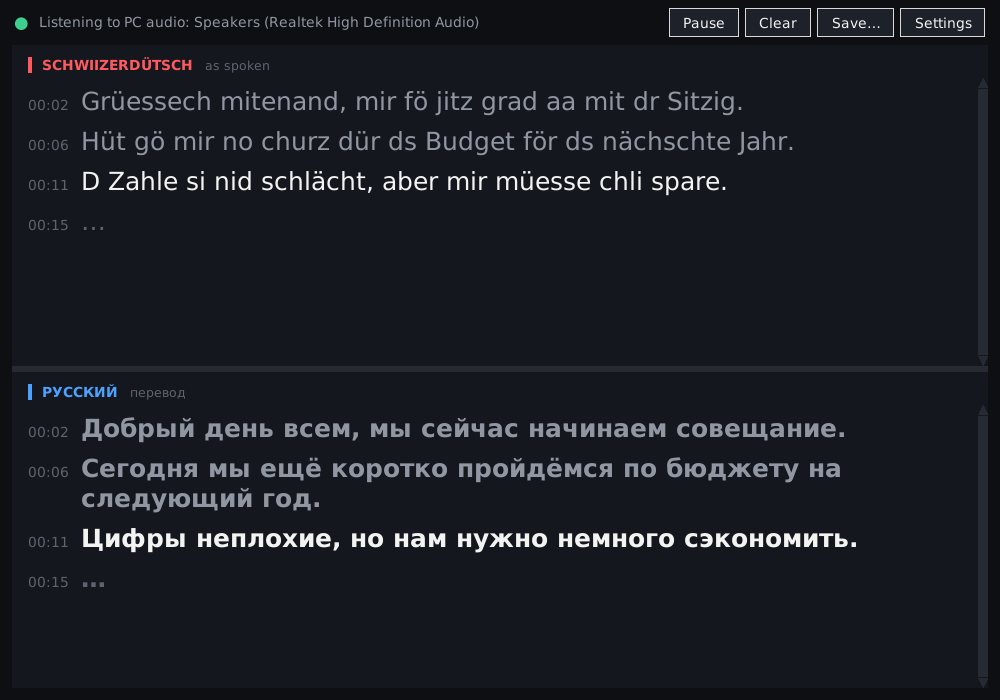

# swiss-ru-de

Live **Swiss German → Russian / German** subtitles for anything you hear on your PC:
Teams or Zoom calls, YouTube, SRF Play, podcasts, or audio and video files.



The window has two parts:

* **Top: Schwiizerdütsch as spoken.** What the speaker said, written in dialect.
* **Bottom: the translation.** Russian or Standard German; you choose in **Settings**.

Each sentence shows up in both parts on the same row, with the same time stamp. Drag the bar
between the parts to resize them.

```
PC audio ─► pause detection ─┬► Whisper fine-tuned on Swiss German ─► Standard German ─► Russian   (bottom)
(Teams, YouTube, …)          └► Whisper + dialect style prompt ─────► dialect as spoken           (top)
```

* **Dialects.** The default speech model is Whisper large-v3-turbo fine-tuned on Swiss German.
  Its training data (STT4SG-350, SDS-200, SwissDial, Swiss Parliaments Corpus) covers Bern, Basel,
  Zurich, Valais, Grisons, and Central and Eastern Switzerland. You don't need to pick a dialect.
  The model writes what it hears as Standard German.
* **Fast.** It runs locally with [faster-whisper](https://github.com/SYSTRAN/faster-whisper).
  On an NVIDIA GPU a sentence should appear about a second after the speaker pauses; on a modern
  CPU expect a few seconds. If the computer falls behind, waiting sentences are joined and
  recognised together, so it catches up.
* **Simple.** Double-click to start. Besides the two-part window, there is a compact
  always-on-top subtitle strip (`--overlay`), terminal output, and `.srt` or `.txt` export.

## iPhone

There is also an iPhone app with the same two-part screen. It runs speech recognition on the
iPhone itself and listens to the microphone, to other apps on the iPhone (YouTube, …) or to
files. It can show floating captions over other apps. See **[ios/README.md](ios/README.md)**
for installing it with Xcode, or with Sideloadly on Windows using the `.ipa` built by
GitHub Actions.

## Install

**Windows:** install [Python 3.10+](https://www.python.org/downloads/) and tick *"Add python.exe
to PATH"*. Then double-click **`start-windows.bat`**. The first start installs everything and
downloads the models (a few GB, once). After that, the two-part window opens and shows
whatever your PC is playing.

**Manual install (Windows, Linux, macOS):**

```bash
git clone https://github.com/x-daemon/swiss-ru-de && cd swiss-ru-de
python -m venv .venv && source .venv/bin/activate     # Windows: .venv\Scripts\activate
pip install -e ".[all]"      # or only what you need: ".[claude]", ".[deepl]", ".[offline]"
```

## The window

```bash
swiss-ru-de --gui                    # or: swiss-ru-de-gui (no console window), start-windows.bat
swiss-ru-de --gui --url "https://www.youtube.com/watch?v=..."   # a whole video in the window
```

| Button / key | What it does |
|---|---|
| **Settings** (Ctrl+,) | Choose the bottom part: **Русский** or **Hochdeutsch**. Choose the top part: dialect as spoken, or Standard German. Also: dialect hint, translator, which speaker, microphone or headset to listen to, font size, always on top, speech model. Settings are saved and apply immediately. Only the speech model and the GPU/CPU choice need a restart. |
| **Pause** (Space) | Ignore audio for a moment, e.g. during a private side conversation. |
| **Save…** (Ctrl+S) | Export everything to `.srt` subtitles or `.txt`. |
| **Clear** (Ctrl+L) | Empty both parts. |
| Ctrl + / Ctrl − | Change the font size. |

**How the dialect line works.** The Swiss German speech models are trained to write Standard
German, so the top part uses a second model. It is plain Whisper, guided by a short example text
written in the chosen dialect (for example Bärndütsch for `bern`, Baseldytsch for `basel`), so
that it writes what it hears the same way. Swiss German has no fixed spelling, so the top line is
an approximation of what was said. The bottom line (meaning, translation) comes from the Swiss
German model. On CPU-only PCs, the second model roughly doubles the work. If the PC can't keep
up, set the top part to *Standard German*.

## Command line

```bash
swiss-ru-de                          # everything playing on the PC -> Russian, in the terminal
swiss-ru-de --dialect-text           # ... with the dialect as spoken above each line
swiss-ru-de --overlay                # ... in a floating subtitle window
swiss-ru-de --to de                  # Standard German only (no translation, fastest)
swiss-ru-de --to both --overlay      # German (small) + Russian (large)
swiss-ru-de --device "Headset"       # listen to a specific speaker or headset, see --list-devices
swiss-ru-de --url "https://www.youtube.com/watch?v=..." --to both --save video.srt
swiss-ru-de --file interview.mp4 --save interview.srt
```

| Source | How |
|---|---|
| **Teams / Zoom / Webex** | Just run it. It captures the speaker or headset that Teams plays on. If that is not your default device, use `--device "<name>"` (see `--list-devices`). |
| **YouTube in the browser** | Just run it and press play. |
| **YouTube link** | `--url <link>` downloads only the audio and processes it faster than real time. |
| **Files** | `--file` takes any audio or video file (mp3, m4a, wav, mp4, mkv, …). |
| **Microphone** | `--mic` (add `--device` to choose one). |

Overlay window: drag it with the mouse, use the mouse wheel to change the font size, and
double-click or press Esc to close it.

> Recording or transcribing a conversation without the consent of the participants is restricted
> in Switzerland (Art. 179bis/ter StGB). Tell the people in your call before you use this.

## Translation to Russian

| `--translator` | Quality | Needs | Notes |
|---|---|---|---|
| `claude` | best | Claude API key (Settings) | Uses the previous sentences as context, fixes obvious recognition errors, handles leftover dialect words (*öppis, gäll, lueg …*). Default model `claude-opus-5-5` at low effort. Use `--claude-model claude-haiku-5-5` for lower cost and latency. |
| `deepl` | very good | `DEEPL_AUTH_KEY` | The [free API key](https://www.deepl.com/pro-api) covers 500 000 characters/month. |
| `offline` | good | nothing | NLLB-200 600M runs locally. Nothing leaves your PC. |

The default is `auto`: it uses Claude if `ANTHROPIC_API_KEY` is set, DeepL if `DEEPL_AUTH_KEY`
is set, and the offline model otherwise.

```bash
# Windows (PowerShell):  $env:ANTHROPIC_API_KEY="sk-ant-..."
export ANTHROPIC_API_KEY=sk-ant-...
swiss-ru-de --to both --dialect berner-oberland
```

## Dialects and accuracy tips

* All dialects are recognised automatically. The dialect setting (`--dialect bern|berner-oberland|basel|zurich|wallis|…`)
  is an optional hint. It sets the spelling style of the dialect line and gives the Claude
  translator context.
* **Highest Alemannic** dialects (Bernese Oberland, e.g. Grindelwald, and Valais) are the hardest
  for every model. For these, try `--model swiss-large` (slower, often more accurate) and
  `--beam 5`.
* Use `--hint "Grindelwald, Eiger, Jungfraubahn, Frau Wyss"` to give the model names and terms
  that come up in the audio.
* Speech models:

  | `--model` | What it is |
  |---|---|
  | `swiss-turbo` (default) | large-v3-turbo + Swiss German fine-tune: fast, good |
  | `swiss-turbo-int8` | the same model, int8 quantised: smaller, for CPU-only PCs |
  | `swiss-large` | large-v3 + Swiss German LoRA (MIT): slower, often more accurate |
  | `turbo`, `large` | original OpenAI Whisper, no Swiss fine-tune |
  | any Hugging Face repo or local folder | must be in faster-whisper (CTranslate2) format |

  If a preset can't be downloaded, the tool falls back to plain `large-v3-turbo`.

## Speed and precision: choose the recogniser

| Recogniser (Settings → *Recognise with*) | Speed | Notes |
|---|---|---|
| **Azure cloud (de-CH)** | Text appears *while* people speak; the final sentence ~1 s after the pause | Microsoft's [Swiss German dialect model](https://azure.microsoft.com/en-gb/updates/release-of-swiss-german-dialect-speech-to-text/). Writes Standard German. No CPU load. Free tier: 5 h audio per month, then about 1 USD per hour. Only speech is sent, not silence. |
| **This PC + NVIDIA GPU** | about 1 s per sentence | Free and private. `start-windows.bat` installs the CUDA libraries automatically. |
| **This PC, CPU only** | a few seconds per sentence | Free and private, but slow on weak PCs. |

**Setting up Azure (5 minutes, free tier):**

1. Sign in at [portal.azure.com](https://portal.azure.com) (a free account works).
2. *Create a resource → Speech*.
3. Choose region **Switzerland North** and pricing tier **Free F0**, then create it.
4. Open the resource → *Keys and Endpoint* → copy **Key 1**.
5. In swiss-ru-de *Settings*, set *Recognise with* to **Azure cloud**, paste the key, and
   check that the region is `switzerlandnorth`. Save.

The key is stored in the Windows Credential Manager. On the command line use
`--recognizer azure` with the `AZURE_SPEECH_KEY` environment variable. Names and terms from
`--hint` are passed to Azure as a phrase list. Files and YouTube links always use the local
recogniser.

With Azure, the dialect line (top) still comes from the local model. It is filled in when the
CPU has time; until then the top shows the Standard German, dimmed.

**On this PC (no cloud) it tunes itself.** At start it times one pass of the speech model,
which costs the same for every sentence (a 30 s window). Live mode then picks:

| Time per pass | Mode | What changes |
|---|---|---|
| ≤ 1 s (GPU) | precise | wider search (beam 5), dialect line on, segments from 2 s |
| 1–2.5 s | balanced | dialect line only when idle, segments ≥ 2× the pass time |
| > 2.5 s (slow CPU) | fast | dialect line paused (it would double the work and hold up the next sentence), segments of 2× the pass time (max 8 s), so recognition keeps up |

Force a mode in *Settings → Speed* (or `--speed fast|precise`). *Settings → Check this PC…*
or `swiss-ru-de --benchmark` shows the processor, the graphics card, the measured time per
pass, and what would make this PC faster. For example, an NVIDIA card whose CUDA libraries
are missing.

**Further details:**

* Short utterances are joined (at least ~3 s, up to a 1.5 s pause). Whisper is more precise
  with more context, and every recognition pass costs the same 30 s window, so this is also
  faster. Change it with `--min-seconds`.
* Live mode decodes once (no retry passes). With a GPU it searches wider (beam 5) for more
  precision.
* The dialect line is filled in only when no other speech is waiting.
* GPU: `start-windows.bat` detects an NVIDIA card and installs cuBLAS/cuDNN with pip (about
  1 GB, once). Manual install: `pip install -e ".[all,gpu]"`.

## Translation quality

**With Claude, recognition errors are corrected too.** Claude can't listen to audio: the
Claude API accepts text and images only, so speech recognition stays on your PC (Whisper on
the GPU or CPU), or optionally Azure. For each sentence Claude gets:

* the recognised Standard German;
* the dialect line, as a second hearing of the same audio (it waits for it at most 1.5 s);
* the previous sentences.

It returns the **corrected German sentence and its translation** in one request (JSON
output). Misheard words are fixed (*Gipfel* at breakfast → *Gipfeli*), and the corrected
German is what the window, the transcript and the next sentence's context use. With the
bottom part set to *Hochdeutsch*, Claude only corrects the German.


The bottom header shows which translator is active (e.g. *перевод · offline, basic
quality*). The offline translator is free, but translates literally. For example it turns *Zmorge*
(breakfast) into "tomorrow". About 45 common Swiss words (Zmorge, Gipfeli, Weggli, Schoggi, Peperoni, Velo, Natel,
Spital, …) are replaced by Standard German before it translates. Context is used too:
*Gipfel* in a sentence about breakfast or a bakery becomes *Croissant*, not a mountain peak.
This helps, but a small offline model still translates word by word. The real fix is
**Claude** (best: uses the earlier sentences, knows Swiss words, corrects recognition errors)
or **DeepL**. Paste a key in *Settings → Claude API key / DeepL API key*. Under *Claude model*,
choose **Opus 5.5** (best) or **Haiku 5.5** (fastest, a fraction of the cost). It is stored in the
Windows Credential Manager, not in a file.

## Platform notes

* **Windows:** captures system audio directly (WASAPI loopback). Nothing else to install.
* **Linux:** captures PulseAudio or PipeWire "monitor" sources directly.
* **macOS:** macOS can't capture system audio by itself. Install
  [BlackHole](https://github.com/ExistentialAudio/BlackHole), create a *Multi-Output Device*
  (speakers + BlackHole) in Audio MIDI Setup, then run `swiss-ru-de --mic --device BlackHole`.

## Troubleshooting

| Problem | Fix |
|---|---|
| Nothing appears | Run `swiss-ru-de --list-devices` and pick the device that actually plays the sound with `--device`. |
| It crashes at start with a `cudnn`/`cublas` error | Use `--cpu`, or install the CUDA libraries (see Speed). |
| Text appears during music or silence | Known Whisper "hallucinations" (TV subtitle credits and similar) are filtered out. Report others in an issue. |
| Sentences are cut in the middle | Raise `--pause-ms` (e.g. 900). |

## Development

```bash
pip install -e ".[dev,claude,deepl]"
pytest
```

Code layout: `audio.py` (capture), `segmenter.py` (pause detection), `asr.py` (faster-whisper,
dialect prompts), `translate.py` (Claude / DeepL / offline), `pipeline.py` (threads),
`gui.py` (two-part window and settings), `settings.py`, `output.py` / `overlay.py` (display).

**Status (v0.2):** the full pipeline is covered by tests that use simulated audio and a simulated
model. The window was checked on a virtual display. It has not yet been benchmarked on real Swiss
German recordings, and how well the dialect line follows each dialect is untested. Feedback per
dialect is welcome.

---

## Кратко по-русски

Программа в реальном времени переводит швейцарский немецкий (все диалекты: Берн, Базель, Цюрих,
Гриндельвальд/Бернский Оберланд, Вале и др.) на русский или литературный немецкий. Она слушает всё,
что звучит на компьютере: Teams, YouTube, файлы.

1. Установите Python 3.10+ (отметьте «Add python.exe to PATH»).
2. Запустите `start-windows.bat`. Первый запуск устанавливает программу и скачивает модели (несколько ГБ).
3. Откроется окно из двух частей. Сверху: швейцарский немецкий, как его произнесли (на диалекте).
   Снизу: перевод на русский или литературный немецкий; выбор в **Settings**.

Чтобы было **быстро и точно** на компьютере без видеокарты NVIDIA:

1. *Settings → Recognise with → Azure cloud*, ключ Azure Speech (регион Switzerland North,
   5 бесплатных часов в месяц). Текст появляется прямо во время речи.
2. Ключ **Claude** или **DeepL** в *Settings*. Без ключа используется офлайн-перевод,
   а он переводит дословно и с ошибками.

Полностью локально, без облака, программа сама подстраивается под скорость компьютера.
*Settings → Check this PC…* показывает процессор, видеокарту и замеренную скорость, а также
что ускорит работу именно на этом компьютере. Самое большое ускорение (примерно в 10 раз)
даёт видеокарта NVIDIA.

## License

MIT. The speech and translation models have their own licences; check them on their model pages
before commercial use.
